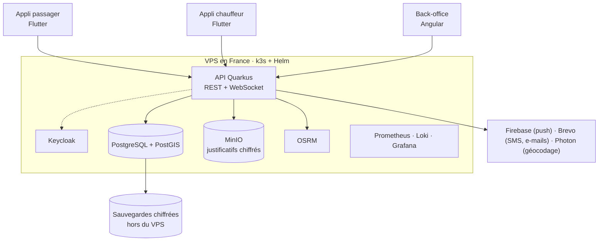
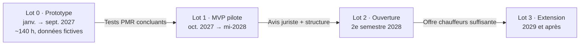

# Cahier des charges – Nautilus (nom de code)

Application VTC dédiée aux PMR (Nantes)

Version du 20 novembre 2026 · Fouad

## 1. Contexte, objectifs et périmètre

Le projet vise une application de réservation de VTC réservée aux personnes à mobilité réduite (PMR), lancée à Nantes. C'est un side project, développé par une seule personne, avec un budget quasi nul hors temps de développement.

### Constat

- À Nantes, l'offre PMR publique (Proxitan) est réservée aux titulaires d'une carte d'invalidité à 80 % minimum et se réserve uniquement par téléphone, en semaine, de 8h15 à 16h.
- Les offres privées (Uber Access, G7 Access, VeebyA) sont concentrées en Île-de-France.
- Aucune appli grand public ne permet aujourd'hui, à Nantes, de réserver un chauffeur adapté à son besoin précis, à la demande ou à l'avance.

### Objectifs

1. Permettre à toute PMR de réserver un trajet adapté à son besoin, sans justificatif d'invalidité.
2. Mettre en relation passagers et chauffeurs VTC équipés et formés à l'accompagnement PMR.
3. Proposer une appli utilisable par tous, y compris avec un lecteur d'écran ou à la voix.

### Public cible

- Personnes en fauteuil roulant (manuel ou électrique)
- Seniors à mobilité réduite
- Personnes avec un handicap sensoriel (malvoyantes, malentendantes)
- Personnes avec une déficience intellectuelle, seules ou accompagnées
- Personnes en mobilité réduite temporaire (blessure, convalescence, grossesse)

### Modèle

Marketplace : des chauffeurs VTC indépendants, inscrits au registre VTC, proposent leurs services via la plateforme. La plateforme ne possède ni véhicules ni salariés chauffeurs.

Zone de lancement : Nantes Métropole, plus les trajets vers l'aéroport Nantes Atlantique et la gare de Nantes. Le service est gratuit pour tous ; les frais d'exploitation sont pris en charge par le porteur du projet. Le code source est public sous licence PolyForm Noncommercial 1.0.0 : réutilisation, modification et redistribution libres, sauf usage commercial.

### Périmètre par phase

| Phase | Contenu | Usage |
| --- | --- | --- |
| Lot 0 – Prototype | Appli passager, appli chauffeur, back-office minimal, données fictives | Démo, tests utilisateurs avec des PMR et des associations |
| Lot 1 – MVP | Réservation planifiée, profil de besoins, matching, paiement | Pilote fermé à Nantes avec quelques chauffeurs |
| Lot 2 – Ouverture | Réservation immédiate, notation, certification chauffeurs | Lancement public à Nantes |
| Lot 3 – Extension | Autres villes, partenariats (mutuelles, établissements de santé) | Croissance |

Le passage du lot 0 au lot 1 implique d'exploiter réellement une plateforme VTC, avec ses obligations légales (section 7). Ce passage est un point de décision, pas une suite automatique.

## 2. Analyse de l'existant et différenciation

Aucun acteur ne combine aujourd'hui à Nantes la réservation à la demande, l'ouverture à toutes les PMR et la prise en compte détaillée des besoins.

| Acteur | Type | Zone | Public | Réservation | Limites pour Nantes |
| --- | --- | --- | --- | --- | --- |
| [Proxitan / Naolib](https://metropole.nantes.fr/transports-pmr) | Transport public à la demande | Nantes Métropole | Carte d'invalidité ≥ 80 % | Téléphone, en semaine 8h15–16h | Pas d'appli, pas d'immédiat, public restreint |
| [Uber Access (WAV)](https://www.uber.com/fr/fr/ride/uberwav/) | Option d'une plateforme VTC | Marchés sélectionnés | Fauteuil, seniors | Appli, immédiat ou jusqu'à 30 jours | Disponibilité à Nantes non confirmée |
| [G7 Access](https://www.g7.fr/en/our-commitments) | Taxis adaptés | Île-de-France surtout | Fauteuil, plancher bas, breaks | Appli, site, téléphone | Peu ou pas présent à Nantes |
| [VeebyA](https://informations.handicap.fr/a-veebya-uber-francais-handi-friendly-33245.php) | Appli VTC PMR | Île-de-France | Tous handicaps | Appli, à l'avance | Pas présent à Nantes, activité actuelle à vérifier |
| Transporteurs TPMR locaux (ex. [Monamiligo](https://www.observatoire-transports.pays-de-la-loire.developpement-durable.gouv.fr/IMG/pdf/4-_geoffroy_guillonneau_-_monamiligo.pdf)) | Entreprises de transport spécialisé | Bretagne, Pays de la Loire | Fauteuil, scolaire, marchés publics | Contrats, téléphone | Pas d'appli grand public – partenaires potentiels |

Donnée utile : en 2020, les voyages Proxitan se répartissaient entre 47 % de personnes avec déficience intellectuelle, 19 % marche/moteur, 16 % fauteuil et 18 % sensoriel ([Semitan](https://semitan.tan.fr/la-presentation-des-nouveaux-minibus-proxitan)). Le fauteuil n'est donc qu'une partie du besoin.

### Différenciation

1. **Profil de besoins détaillé** : type de fauteuil, transfert possible ou non, aide requise, accompagnant, chien guide. Le matching en dépend.
2. **Appli 100 % accessible** : conçue dès le départ pour les lecteurs d'écran, la commande vocale et les grands caractères.
3. **Chauffeurs certifiés PMR** : formation à l'accompagnement vérifiée, notation spécifique.
4. **Ancrage local** : Nantes d'abord, là où les grands acteurs sont absents.

### Questions ouvertes

- [ ] Uber Access est-il disponible à Nantes aujourd'hui ? À vérifier dans l'appli Uber.
- [ ] Combien de VTC avec véhicule adapté (rampe) exercent à Nantes ?

Décision : les personnes avec une déficience intellectuelle font partie du public dès le MVP.

## 3. Personas et parcours utilisateurs

Six personas couvrent les publics visés et les trois types de réservants (passager, aidant, établissement). Les personas sont des hypothèses à confronter à des entretiens réels.

| Persona | Profil | Besoin clé | Contrainte appli |
| --- | --- | --- | --- |
| Karim, 34 ans | Fauteuil électrique, ne peut pas être transféré | Véhicule avec rampe, fixation du fauteuil | Utilise l'appli seul, motricité des mains réduite |
| Monique, 79 ans | Senior, déambulateur | Aide à la montée, chauffeur patient | Peu à l'aise avec le smartphone, grands caractères |
| Sophie, 45 ans | Aveugle, chien guide | Chien accepté, chauffeur qui annonce son arrivée | Lecteur d'écran (VoiceOver, TalkBack) |
| Lucas, 28 ans | Jambe plâtrée pour 6 semaines | Berline avec place pour allonger la jambe, béquilles | Usage ponctuel, inscription rapide |
| Nadia, 52 ans | Aidante de sa mère en fauteuil manuel | Réserver à distance, suivre le trajet | Gère le profil d'une autre personne |
| EHPAD des Bords d'Erdre | Établissement | Réserver pour plusieurs résidents (rendez-vous médicaux) | Compte multi-passagers |

Persona complémentaire : **Julien, 24 ans**, déficience intellectuelle légère, se rend seul à son travail en ESAT. Il a besoin d'un chauffeur patient, de consignes simples et d'une confirmation d'arrivée envoyée à ses parents, qui réservent pour lui.

Côté offre, un persona chauffeur : **Thierry, 50 ans**, VTC indépendant à Nantes, minibus avec rampe, veut remplir ses creux d'activité avec des courses PMR planifiées.

### Parcours 1 – Le passager réserve une course planifiée

1. Il crée son compte et remplit son profil de besoins (une fois).
2. Il saisit départ, arrivée, date et heure, aller simple ou aller-retour.
3. L'appli affiche les chauffeurs compatibles avec son profil, leur tarif et leur note.
4. Il choisit un chauffeur et envoie la demande.
5. Le chauffeur accepte ou refuse dans un délai fixé ; en cas de refus, le passager en choisit un autre.
6. Rappel la veille et une heure avant ; suivi du chauffeur en approche.
7. Course effectuée, paiement direct au chauffeur, notation des deux côtés.

### Parcours 2 – L'aidant ou l'établissement réserve pour un tiers

1. Il crée un compte réservant et ajoute un ou plusieurs passagers, chacun avec son profil de besoins.
2. Il réserve en choisissant le passager concerné ; le reste suit le parcours 1.
3. Il reçoit les notifications (acceptation, approche, arrivée) ; le passager peut aussi les recevoir par SMS.

### Parcours 3 – Le chauffeur rejoint la plateforme

1. Il s'inscrit et dépose ses justificatifs (carte VTC, inscription au registre VTC, assurance, carte grise).
2. Il décrit son véhicule et ses équipements, puis fixe ses tarifs et ses disponibilités.
3. L'administrateur vérifie les documents et la formation PMR, puis active le compte.
4. Il reçoit les demandes compatibles avec son véhicule et les accepte ou les refuse.

## 4. Fonctionnalités

Le MVP (lot 1) couvre la réservation planifiée de bout en bout ; l'immédiat, la certification et les comptes établissement complets arrivent au lot 2. La plateforme ne fixe pas les prix et n'encaisse pas : chaque chauffeur fixe son tarif et est payé directement.

### 4.1 Appli passager / réservant

| Fonctionnalité | Description | Lot |
| --- | --- | --- |
| Inscription | E-mail ou téléphone, code de vérification ; pas de justificatif d'invalidité | 1 |
| Profil de besoins | Questionnaire guidé (section 5), modifiable, plusieurs profils pour un aidant | 1 |
| Comptes aidant | Un réservant gère un ou plusieurs passagers | 1 |
| Réservation planifiée | Départ, arrivée, date, heure, aller-retour, accompagnant, commentaire libre ; au moins 12 h à l'avance | 1 |
| Choix du chauffeur | Liste des chauffeurs compatibles : tarif estimé, note, équipements, badge certifié | 1 |
| Suivi de la réservation | Statuts (envoyée, acceptée, en route, arrivé, terminée), annulation | 1 |
| Notifications | Push, SMS, e-mail ; rappel la veille et une heure avant | 1 |
| Suivi en temps réel | Position du chauffeur en approche | 1 |
| Notation | Note globale publique et critères PMR (ponctualité, qualité de l'aide, respect du matériel), commentaire | 1 |
| Historique et favoris | Trajets et chauffeurs favoris, re-réserver en un geste | 2 |
| Réservation immédiate | Demande diffusée aux chauffeurs compatibles disponibles | 2 |
| Réservations récurrentes | Ex. dialyse trois fois par semaine | 2 |
| Compte établissement | Plusieurs résidents, plusieurs gestionnaires, export des trajets | 2 |
| Assistant vocal | Réserver à la voix de bout en bout | 3 |

### 4.2 Appli chauffeur

| Fonctionnalité | Description | Lot |
| --- | --- | --- |
| Inscription et justificatifs | Carte VTC, attestation registre VTC, assurance, carte grise, photo | 1 |
| Fiche véhicule | Type, rampe ou hayon, nombre de places fauteuil, systèmes de fixation, espace coffre | 1 |
| Compétences | Formations suivies, aides proposées (transfert, accompagnement porte à porte), langue des signes | 1 |
| Tarifs | Prise en charge, prix au km, prix à la minute, suppléments (attente, aide), accompagnant gratuit ou payant | 1 |
| Disponibilités | Créneaux hebdomadaires, zone d'intervention | 1 |
| Demandes | Réception, détail du profil du passager, accepter ou refuser | 1 |
| Course | Navigation (lien vers Waze ou Google Maps), statuts, contact du passager | 1 |
| Historique | Courses réalisées, montants déclarés | 1 |
| Mode immédiat | Se déclarer disponible et recevoir des demandes à la demande | 2 |

### 4.3 Back-office administrateur

| Fonctionnalité | Description | Lot |
| --- | --- | --- |
| Validation des chauffeurs | Contrôle des documents, vérification au registre VTC, activation | 1 |
| Suivi des courses | Liste, statuts, incidents | 1 |
| Modération | Signalements, suspension de comptes | 1 |
| Gestion des dates d'expiration | Alerte quand un document chauffeur expire | 1 |
| Certification PMR | Badge attribué sur attestation de formation d'un organisme reconnu, vérifiée par l'administrateur | 2 |
| Statistiques | Courses, taux d'acceptation, demandes non servies par zone et horaire | 2 |

### Décisions

| Sujet | Décision |
| --- | --- |
| Délai minimal | 12 h entre la réservation et la course |
| Réponse du chauffeur | 1 h pour accepter ou refuser ; sans réponse, la demande expire et le passager est prévenu |
| Annulation | Sans frais ; annulations tardives comptées des deux côtés, avertissement à la 2e annulation tardive et suspension temporaire à la 3e sur 30 jours |
| Financement | Service gratuit pour tous ; frais d'exploitation pris en charge par le porteur du projet |
| Accompagnant | Gratuit ou payant au choix du chauffeur, affiché dans sa grille |
| Notation | Note moyenne publique et détail par critère PMR |
| Applis | Deux applis Flutter séparées (passager, chauffeur), code commun dans un package partagé |

### Sécurité et cas limites

| Sujet | Décision |
| --- | --- |
| Mineurs | Passagers majeurs uniquement, ou mineurs accompagnés d'un adulte |
| Incident en course | Bouton d'urgence (appel du 112), alerte immédiate à la personne à prévenir, formulaire de signalement après la course |
| Litiges | La plateforme transmet le signalement ; passager et chauffeur règlent entre eux. La modération n'intervient que sur les comptes (suspension) |
| Aller-retour avec attente | Une seule course, même chauffeur, attente facturée selon son tarif |
| Identité des passagers | Téléphone vérifié, pas de pièce d'identité |
| Facture | Établie par le chauffeur, hors appli |
| Langue | Français uniquement au MVP |

## 5. Profil de besoins et matching

Le profil décrit des besoins fonctionnels (ce qu'il faut pour le trajet), jamais un diagnostic médical. Ce choix réduit les risques liés aux données de santé (section 7) tout en suffisant au matching.

### 5.1 Contenu du profil passager

| Rubrique | Champs | Usage |
| --- | --- | --- |
| Mobilité | Fauteuil manuel pliable / manuel non pliable / électrique ; déambulateur ; béquilles ; aucun | Filtre véhicule |
| Fauteuil | Largeur, longueur, poids avec occupant (tranches) | Compatibilité rampe et habitacle |
| Transfert | Peut passer sur un siège seul / avec aide / impossible | Rampe obligatoire ou non |
| Aide requise | Aucune ; aide à la montée ; accompagnement porte à porte ; port de bagages | Compétences chauffeur |
| Sensoriel | Malvoyant, malentendant, communication préférée (SMS, appel, LSF) | Mode de contact, annonce de l'arrivée |
| Accompagnement | Accompagnant, chien guide ou d'assistance | Places, acceptation du chien |
| Confort | Place pour allonger une jambe, siège avant, besoin de temps | Choix du véhicule, durée prévue |
| Note libre | Texte libre visible du chauffeur | Précisions |

Rubrique ajoutée pour la déficience intellectuelle : **Autonomie et communication** — se déplace seul ou accompagné, consignes au chauffeur (ex. remettre à une personne nommée), personne à prévenir au départ et à l'arrivée.

### 5.2 Contenu du profil chauffeur

Le profil chauffeur reprend les mêmes rubriques en miroir : équipements du véhicule (rampe, hayon, fixations, dimensions d'accès, places fauteuil), aides proposées, formations, acceptation des chiens, zone et disponibilités.

### 5.3 Règles de matching

1. **Contraintes bloquantes** : le véhicule doit accepter le fauteuil (type, dimensions, poids) ; rampe obligatoire si transfert impossible ; aide requise proposée par le chauffeur ; chien accepté si présent ; places suffisantes.
2. **Disponibilité** : le chauffeur est disponible sur le créneau et le départ est dans sa zone.
3. **Classement** des chauffeurs restants, au choix du passager : prix estimé, note, distance d'approche, badge certifié, chauffeurs favoris en premier.
4. **Aucun chauffeur compatible** : la demande est enregistrée comme « non servie » (statistique utile) et le passager est orienté vers Proxitan ou un transporteur TPMR.

Le matching reste volontairement simple au MVP : un filtrage par règles, puis un tri. Pas d'algorithme d'attribution automatique, le passager choisit son chauffeur.

### 5.4 Calcul du prix estimé

Chaque chauffeur définit sa grille ; l'appli calcule une estimation affichée avant la demande :

```latex
Prix = Prise\ en\ charge + Prix_{km} \times Distance + Prix_{min} \times Durée + Suppléments
```

Distance et durée viennent d'un service de calcul d'itinéraire (section 8). Le montant final est réglé directement au chauffeur.

### Décisions

- Le chauffeur voit le profil complet avant d'accepter une demande ; le passager en est informé quand il remplit son profil.
- Tarifs : transparence seule. Le prix estimé est affiché en détail (base, distance, durée, suppléments) avant la demande, sans plafond imposé.

## 6. Accessibilité de l'application

L'appli vise le niveau AA des WCAG 2.2 sur mobile et sur le back-office, vérifié avec de vrais utilisateurs. C'est un argument de différenciation, pas une option.

### 6.1 Référentiels

- **WCAG 2.2 niveau AA** : référence technique pour toutes les interfaces.
- **RGAA** : déclinaison française des WCAG, utile comme grille d'audit.
- **European Accessibility Act** (applicable depuis juin 2025) : couvre certains services numériques liés au transport de voyageurs ; les micro-entreprises sont en principe exemptées. Applicabilité au projet à faire confirmer.

### 6.2 Exigences

| Domaine | Exigence |
| --- | --- |
| Lecteurs d'écran | Chaque élément a un libellé `Semantics` Flutter ; ordre de lecture logique ; testé sous VoiceOver et TalkBack |
| Taille du texte | Respect du réglage système jusqu'à 200 % sans perte d'information |
| Contrastes | Ratio ≥ 4,5:1 pour le texte, ≥ 3:1 pour les composants ; thème sombre et contraste élevé |
| Cibles tactiles | 48 × 48 dp minimum, espacement suffisant (motricité réduite) |
| Gestes | Aucune action uniquement par geste complexe (glisser, pincer) ; toujours un bouton |
| Délais | Pas de délai court imposé à l'utilisateur ; délais ajustables |
| Saisie | Adresses par saisie vocale ; favoris (domicile, hôpital) ; pas de CAPTCHA visuel |
| Carte | La carte n'est jamais la seule source d'information : adresse et temps d'approche en texte |
| Notifications | Chaque information importante existe en texte, en son et en vibration |
| Langage | Phrases courtes, vocabulaire simple (FALC pour les écrans clés) |
| Contact chauffeur | Appel, SMS ou messagerie écrite au choix (malentendants) |

### 6.3 Commande vocale

- Lot 1 : compatibilité avec les commandes vocales du système (Voice Control, Voice Access) grâce aux libellés.
- Lot 3 : assistant vocal intégré pour réserver de bout en bout (« Je veux aller au CHU demain à 9 h »).

### 6.4 Vérification

1. Tests automatiques : `flutter test` avec les guidelines d'accessibilité (`meetsGuideline`) dans la CI.
2. Audit manuel à chaque lot avec la grille RGAA.
3. Tests avec au moins un utilisateur par persona (section 3), via des associations nantaises.
4. Une déclaration d'accessibilité publiée dans l'appli.

## 7. Cadre réglementaire et données personnelles

Le prototype (lot 0) avec données fictives ne déclenche presque aucune obligation ; dès la première vraie course (lot 1), la plateforme devient une centrale de réservation VTC. Cette section liste les pistes ; elle doit être validée par un juriste avant le lot 1.

### 7.1 Statut de la plateforme

- Une plateforme qui met en relation des chauffeurs VTC et des passagers est une **centrale de réservation** et doit déclarer son activité auprès de l'autorité administrative ([Weblex](https://www.weblex.fr/weblex-actualite/plateformes-web-pour-vtc-du-nouveau-a-compter-du-1er-janvier-2019)).
- Les plateformes qui définissent la prestation ou les tarifs relèvent d'une catégorie soumise à inscription sur un registre national ([Weblex](https://www.weblex.fr/weblex-actualite/transport-de-nouvelles-obligations-pour-les-plateformes-numeriques)). Le choix d'un tarif fixé par le chauffeur et d'un paiement direct pourrait éviter cette catégorie : point clé à faire confirmer.
- Une loi du 25 juin 2026 sur les fraudes renforce les obligations des plateformes VTC, codifiées aux articles L.3141-3 et suivants du Code des transports ([CMS](https://cms.law/en/fra/legal-updates/actualites-des-plateformes-numeriques-vers-une-responsabilisation-croissante-des-operateurs)).
- Il faut une structure juridique (micro-entreprise au minimum) pour exploiter la plateforme.

### 7.2 Obligations envers les chauffeurs

| Obligation | Détail | Impact appli |
| --- | --- | --- |
| Vérifier les justificatifs avant toute mise en relation | Carte VTC, inscription de l'exploitant au registre VTC, assurance ([Weblex](https://www.weblex.fr/weblex-actualite/chauffeurs-de-vtc-et-plateformes-web-une-relation-encadree)) | Workflow de validation dans le back-office |
| Vérifier le véhicule | L'immatriculation doit figurer au registre VTC ([Weblex](https://www.weblex.fr/articles/gerer-une-entreprise-de-vtc-ce-qu-il-faut-savoir)) | Contrôle à l'inscription et au renouvellement |
| Conserver les preuves des vérifications | Amendes prévues par mise en relation non conforme | Journal d'audit horodaté |
| Revenu minimum des chauffeurs | 30 € par heure d'activité et 1 € par km prévus par accord de secteur ([Weblex](https://www.weblex.fr/fiches-conseils/gerer-une-entreprise-de-vtc-ce-quil-faut-savoir)) | À vérifier si applicable quand le chauffeur fixe ses prix |
| Transparence et suspension | Règles de mise en relation, de suspension et de résiliation connues des chauffeurs | CGU chauffeur, motifs de suspension tracés |

### 7.3 Données personnelles (RGPD)

- Les informations sur le handicap peuvent être considérées comme des **données de santé**, catégorie sensible : consentement explicite, minimisation, sécurité renforcée.
- Minimisation : le profil décrit des besoins fonctionnels (section 5), jamais une pathologie.
- Le chauffeur voit le profil complet, mais seulement pour les demandes qu'il reçoit ; le passager en est informé et y consent en créant son profil.
- Une analyse d'impact (AIPD) est probablement nécessaire (données sensibles, personnes vulnérables, géolocalisation).
- Hébergement HDS : en principe lié aux données collectées pour des soins ou un suivi médico-social ; probablement non requis ici, à confirmer.
- Géolocalisation du chauffeur collectée seulement pendant une course ou en mode disponible.
- Droits des personnes : export et suppression du compte depuis l'appli.

### 7.4 Autres points

- CGU passager et chauffeur, politique de confidentialité, mentions légales.
- Médiateur de la consommation si la plateforme facture un service aux passagers.
- Assurance responsabilité civile professionnelle de la plateforme.
- Responsabilité en cas d'incident lors de l'aide physique : à répartir clairement entre plateforme et chauffeur dans les CGU.

### Questions pour le juriste

- [ ] Le modèle « tarif chauffeur + paiement direct » place-t-il la plateforme hors de l'obligation d'inscription au registre national ?
- [ ] Le revenu minimum chauffeur s'applique-t-il à ce modèle ?
- [ ] Le profil de besoins est-il une donnée de santé au sens du RGPD ? HDS nécessaire ?
- [ ] Qui est responsable en cas de chute pendant un transfert ?

## 8. Architecture technique

L'architecture tient sur un seul VPS : un monolithe modulaire Quarkus, une base PostgreSQL et des services gratuits ou auto-hébergés. Pas de microservices au MVP ; k3s est retenu pour rester proche des pratiques de production, au prix d'un peu plus de maintenance.



Les trois applications passent par la même API ; seule l'API accède à la base et au stockage, et la base est sauvegardée hors du VPS.

### 8.1 Composants

| Composant | Choix | Raison |
| --- | --- | --- |
| Applis mobiles | Flutter, deux applis séparées (passager, chauffeur) partageant un package commun | iOS et Android, bon support de l'accessibilité (`Semantics`) |
| Back-office | Angular | Stack déjà maîtrisée |
| API | Quarkus, monolithe modulaire, architecture hexagonale par module (comptes, profils, réservations, matching, notifications) | Stack maîtrisée, faible empreinte mémoire, découpage possible plus tard |
| Temps réel | WebSocket Quarkus pour la position du chauffeur | Pas besoin de Kafka à cette échelle |
| Base | PostgreSQL + PostGIS | Requêtes géographiques (zones, distance d'approche) |
| Authentification | Keycloak (OIDC), connexion par code à usage unique | Standard OIDC, rôles et console d'administration prêts |
| Fichiers | MinIO (compatible S3), chiffrement côté serveur | Justificatifs chauffeurs sensibles |
| Itinéraires | OSRM auto-hébergé sur l'extrait OSM Pays de la Loire | Gratuit, sans quota |
| Géocodage | Photon (OSM) ou API Adresse de l'État (adresse.data.gouv.fr) | Gratuit |
| Push | Firebase Cloud Messaging | Gratuit, iOS et Android |
| SMS / e-mail | Brevo | E-mails gratuits jusqu'à un quota ; SMS payants à l'unité |

### 8.2 Modèle de données (principales entités)

| Entité | Champs principaux | Relations |
| --- | --- | --- |
| Utilisateur | id, rôle (passager, réservant, chauffeur, admin), e-mail, téléphone, consentements | — |
| Passager | id, nom, préférences de contact | 1 profil de besoins ; géré par 1 ou n réservants |
| ProfilBesoins | mobilité, fauteuil (type, dimensions, poids), transfert, aides, sensoriel, chien, note | 1 passager |
| Chauffeur | id, n° carte VTC, n° registre exploitant, statut de validation, zone (polygone) | n véhicules, n justificatifs |
| Véhicule | immatriculation, type, rampe, places fauteuil, dimensions d'accès, fixations | 1 chauffeur |
| Justificatif | type, fichier, date d'expiration, statut, vérifié par, vérifié le | 1 chauffeur |
| GrilleTarifaire | prise en charge, prix au km, prix à la minute, suppléments | 1 chauffeur |
| Disponibilité | jour, heure de début, heure de fin | 1 chauffeur |
| Réservation | créneau, départ et arrivée (géographie), prix estimé, statut, accompagnant | 1 passager, 1 réservant, 1 chauffeur |
| PositionCourse | horodatage, point GPS | 1 réservation (purge après la course) |
| Notation | note, commentaire, auteur | 1 réservation |
| JournalAudit | action, acteur, horodatage, détail | Preuve des vérifications (section 7) |
| DemandeNonServie | zone, créneau, besoins (anonymisés) | Statistiques |

Statuts d'une réservation : demandée → acceptée → chauffeur en route → chauffeur sur place → en cours → terminée. Sorties possibles : refusée, expirée, annulée (passager ou chauffeur).

### 8.3 API (principaux points d'entrée)

| Méthode | Route | Rôle |
| --- | --- | --- |
| POST | `/auth/code` puis `/auth/token` | Envoi du code, échange contre un JWT |
| GET / PUT | `/passagers/{id}/profil` | Lire, modifier le profil de besoins |
| POST | `/recherches` | Chauffeurs compatibles pour un trajet et un créneau, avec prix estimés |
| POST | `/reservations` | Créer une demande auprès d'un chauffeur |
| POST | `/reservations/{id}/acceptation` | Le chauffeur accepte (ou `/refus`) |
| POST | `/reservations/{id}/statut` | Changement de statut de la course |
| POST | `/reservations/{id}/annulation` | Annulation |
| WS | `/ws/reservations/{id}/position` | Position du chauffeur en temps réel |
| PUT | `/chauffeurs/{id}/vehicules`, `/tarifs`, `/disponibilites` | Profil chauffeur |
| POST | `/chauffeurs/{id}/justificatifs` | Dépôt de documents |
| POST | `/admin/chauffeurs/{id}/validation` | Validation par l'administrateur (journalisée) |
| POST | `/reservations/{id}/notation` | Noter la course |

Approche contract-first : le fichier OpenAPI est écrit d'abord, dans son propre dépôt ; les interfaces serveur, le client Dart et le client TypeScript en sont générés.

### 8.4 Déploiement

1. Un VPS en France (8 Go de RAM environ) avec k3s : API Quarkus (native en production), PostgreSQL + PostGIS, Keycloak, MinIO, OSRM ; Traefik (inclus dans k3s) et cert-manager pour le TLS.
2. Un chart Helm par composant, valeurs par environnement ; recette et production dans des namespaces séparés.
3. GitHub Actions : tests, analyse des dépendances, images (JVM pour les tests, natif pour la production) publiées sur GHCR, déploiement Helm ; builds Flutter vers TestFlight et Google Play (test interne) sur runners macOS et Linux.
4. Sauvegarde quotidienne chiffrée de PostgreSQL et MinIO vers un stockage externe, test de restauration mensuel.
5. Supervision : Prometheus, Loki et Grafana (environ 1 Go de RAM), métriques Quarkus via Micrometer, alertes par e-mail.
6. Secrets : jamais dans les dépôts publics ; SOPS ou Sealed Secrets pour les manifestes, secrets GitHub pour la CI.

### 8.5 Décisions d'architecture

| Sujet | Décision |
| --- | --- |
| Dépôts | Un dépôt par composant sur GitHub : `api`, `app-passager`, `app-chauffeur`, `flutter-commun`, `back-office`, `contrat-api`, `infra` |
| Contrat | OpenAPI versionné dans `contrat-api`, publié en package ; chaque dépôt dépend d'une version précise |
| Style de l'API | Hexagonal par module : domaine en Java pur, adaptateurs REST, persistance, notifications |
| Persistance | Hibernate ORM + Panache en mode repository, dans les adaptateurs uniquement ; Hibernate Spatial pour PostGIS ; Flyway |
| Build | JVM en développement et en tests, natif GraalVM en production ; build natif vérifié en CI à chaque fusion |
| Authentification | Keycloak ; applis Flutter en Authorization Code + PKCE ; rôles passager, réservant, chauffeur, admin |
| Temps réel | Quarkus WebSockets Next |
| GPS chauffeur | En arrière-plan pendant une course uniquement |
| État Flutter | Riverpod |
| Back-office | Angular + Angular Material |
| Tâches planifiées | Table d'échéances en base (rappels, expirations, purges) traitée par un `@Scheduled` idempotent |
| Tests | Unitaires du domaine, `@QuarkusTest` + Dev Services, Flutter (widgets, accessibilité, intégration), bout en bout en recette |
| Supervision | Prometheus + Loki + Grafana |

### Points d'attention

- **Mémoire** : k3s, Keycloak, OSRM, PostgreSQL, Grafana et la recette sur 8 Go, c'est serré. Surveiller dès le lot 0 ; sinon passer à 16 Go ou sortir la recette.
- **Code par SMS dans Keycloak** : pas natif, il faut une extension (SPI) ou un lien magique par e-mail ; à prototyper tôt.
- **GPS en arrière-plan** : Apple et Google exigent une justification et un message clair au chauffeur ; prévoir du temps de revue.
- **Hexagonal + Panache** : utiliser les repositories Panache, pas les entités « active record », pour garder le domaine indépendant.
- **Un dépôt par composant** : le contrat versionné évite les dérives, mais chaque évolution de l'API touche plusieurs dépôts.

## 9. Exigences non fonctionnelles

Les cibles sont dimensionnées pour un pilote local (quelques dizaines de chauffeurs, quelques centaines de passagers), pas pour une plateforme nationale.

| Domaine | Exigence | Cible MVP |
| --- | --- | --- |
| Disponibilité | Service accessible pour réserver et suivre une course | 99 % mensuel ; les réservations confirmées restent visibles hors ligne dans l'appli |
| Performance | Recherche de chauffeurs compatibles | < 2 s au 95e centile |
| Temps réel | Rafraîchissement de la position du chauffeur | Toutes les 5 à 10 s pendant l'approche |
| Capacité | Charge simultanée | 50 courses actives, 500 utilisateurs connectés |
| Sécurité | Transport et stockage | TLS partout ; chiffrement des justificatifs et des sauvegardes ; mots de passe absents (codes à usage unique) |
| Sécurité | Contrôle d'accès | Rôles stricts ; un chauffeur ne voit que les profils des courses qu'il a reçues |
| Sécurité | Bonnes pratiques | OWASP ASVS niveau 1, dépendances analysées en CI, limitation de débit sur l'authentification |
| Données | Conservation | Positions GPS purgées après la course ; comptes inactifs supprimés après 1 an, avec un e-mail de prévenance ; journal d'audit conservé selon les obligations légales |
| Sauvegarde | Restauration | Perte maximale 24 h, restauration en moins de 4 h |
| Traçabilité | Journal d'audit | Toute validation de chauffeur et tout changement de statut horodatés |
| Compatibilité | Mobiles | iOS 16+ et Android 9+ (à ajuster selon l'usage des seniors) |
| Maintenabilité | Code | Tests automatisés sur le matching et les statuts ; couverture visée 70 % sur le cœur métier |
| Accessibilité | Interfaces | WCAG 2.2 AA (section 6) |
| Sobriété | Coût d'exploitation | Environ 20 € par mois hors frais de stores et SMS |

### Décision

Pas d'accès par téléphone au MVP : les aidants et les établissements réservent pour les personnes qui ne peuvent pas utiliser l'appli.

## 10. Planning, budget et risques

Avec moins de 5 h par semaine à partir de janvier 2027, le prototype est réaliste d'ici septembre 2027 et un pilote réel vers mi-2028. Les durées sont des estimations pour un développeur expérimenté aidé de Claude Code ; Flutter étant nouveau, le lot 0 inclut sa prise en main.



Chaque losange est un point de décision : sans tests concluants, avis juridique ou chauffeurs en nombre suffisant, on ne passe pas au lot suivant.

### 10.1 Découpage du lot 0 (prototype)

1. Mise en place : dépôts GitHub, CI GitHub Actions, VPS, k3s et charts Helm, Keycloak, squelette Quarkus et Flutter (\~25 h).
2. Comptes et authentification par code (\~15 h).
3. Profils de besoins passager et profil chauffeur/véhicule (\~25 h).
4. Recherche, matching et prix estimé avec OSRM (\~25 h).
5. Réservation planifiée et statuts, côté passager et chauffeur (\~25 h).
6. Back-office minimal : validation chauffeurs (\~10 h).
7. Audit d'accessibilité et tests avec 3 à 5 utilisateurs PMR (\~15 h).

### 10.2 Budget (ordres de grandeur, à vérifier)

| Poste | Coût | Quand |
| --- | --- | --- |
| VPS français (8 Go de RAM) | 10 à 20 € par mois | Dès le lot 0 |
| Nom de domaine | \~10 € par an | Dès le lot 0 |
| Compte Google Play | 25 $ une fois | Lot 0 (tests internes) |
| Compte Apple Developer | 99 $ par an | Lot 0 si test iOS, sinon lot 1 |
| SMS (codes, rappels) | Quelques centimes l'unité | Lot 1 ; e-mails et push gratuits au départ |
| Conseil juridique | Quelques centaines d'euros | Avant le lot 1 |

Le lot 0 tient dans environ 250 € la première année. Le conseil juridique est le seul poste qui sort du budget quasi nul ; des pistes moins chères existent (consultations gratuites d'avocats, incubateurs, écoles de droit). Les builds iOS passent par les runners macOS de GitHub Actions, gratuits pour les dépôts publics.

### 10.3 Risques

| Risque | Probabilité | Impact | Parade |
| --- | --- | --- | --- |
| Pas assez de chauffeurs avec véhicule adapté à Nantes | Haute | Bloquant | Recenser l'offre dès maintenant ; démarcher les transporteurs TPMR ; commencer par les besoins sans rampe (seniors, sensoriel, temporaire) |
| Requalification juridique de la plateforme | Moyenne | Élevé | Avis juriste avant le lot 1 ; rester sur un modèle de pure mise en relation |
| Fuite de données sensibles | Faible | Élevé | Minimisation, chiffrement, accès restreints, AIPD |
| Essoufflement du projet solo | Haute | Élevé | Lots courts, démo montrable tôt, chercher un partenaire (association, incubateur) |
| Appli jugée peu accessible par les utilisateurs | Moyenne | Élevé | Tests réels à chaque lot, pas seulement des outils automatiques |
| Incident pendant une aide physique | Faible | Élevé | CGU claires, chauffeurs assurés et formés |
| Refus ou retard en revue App Store | Moyenne | Moyen | Prévoir de la marge ; Android d'abord |

### 10.4 Prochaines étapes

- [ ] Validation terrain (associations, tests utilisateurs, recensement des chauffeurs) : prise en charge par un autre intervenant, hors périmètre du développement.
- [ ] Livrer un prototype fonctionnel et démontrable pour la validation terrain.
- [ ] Vérifier si Uber Access est disponible à Nantes.
- [ ] Préparer les questions pour le juriste (section 7).
- [ ] Ajouter la licence PolyForm Noncommercial 1.0.0 et un accord de contribution (CLA) dans chaque dépôt.
- [ ] Trouver un nom pour l'appli.
- [ ] Démarrer le lot 0 en janvier 2027.

## Sources

- [Nantes Métropole – transports PMR](https://metropole.nantes.fr/transports-pmr)
- [Règlement Proxitan](https://www.lachapellesurerdre.fr/sites/default/files/reglement_proxitan.pdf)
- [Semitan – minibus Proxitan et répartition des voyages](https://semitan.tan.fr/la-presentation-des-nouveaux-minibus-proxitan)
- [Uber Access (WAV)](https://www.uber.com/fr/fr/ride/uberwav/)
- [G7 – engagements et G7 Access](https://www.g7.fr/en/our-commitments)
- [Handicap.fr – VeebyA](https://informations.handicap.fr/a-veebya-uber-francais-handi-friendly-33245.php)
- [Weblex – centrales de réservation VTC](https://www.weblex.fr/weblex-actualite/plateformes-web-pour-vtc-du-nouveau-a-compter-du-1er-janvier-2019)
- [Weblex – vérifications des plateformes](https://www.weblex.fr/weblex-actualite/chauffeurs-de-vtc-et-plateformes-web-une-relation-encadree)
- [Weblex – catégories de plateformes](https://www.weblex.fr/weblex-actualite/transport-de-nouvelles-obligations-pour-les-plateformes-numeriques)
- [Weblex – gérer une entreprise de VTC](https://www.weblex.fr/fiches-conseils/gerer-une-entreprise-de-vtc-ce-quil-faut-savoir)
- [CMS – loi du 25 juin 2026 sur les plateformes](https://cms.law/en/fra/legal-updates/actualites-des-plateformes-numeriques-vers-une-responsabilisation-croissante-des-operateurs)
